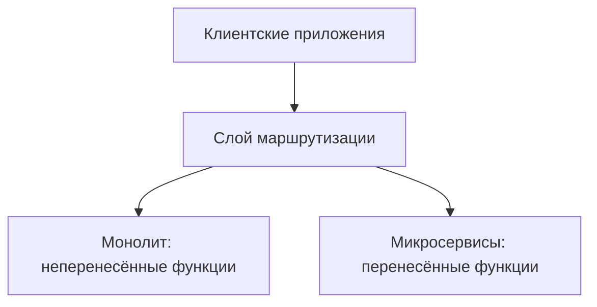

# ADR-001: Целевая архитектура GoFuture и план перехода от монолита к микросервисам

**Статус:** ✅ Принято
 
**Участники:** skorogod

**Дата:** 2026-11-07 

---

## 1. Контекст
В процессе выхода на рынки Юго-Восточной Азии и Южной Америки компания GoFuture столкнулась с проблемами при масштабировании монолитной архитектуры. Пиковые нагрузки (более 100 тысяч активных поездок) вызывают каскадные отказы, разработка новых функций затягивается минимум на полгода, а среднее время восстановления (MTTR) превышает четыре часа.

---

## 2. Требования

### Функциональные
<Используйте один из форматов>

**FURPS+**:
| Категория       | Требование                  |
|-----------------|-----------------------------|
| **F**unctional  | Функциональные требования |
| **F1**  |  Динамическое ценообразование с реалтайм-адаптацией цен на основе спроса и предложения |
| **F2**  |  Оптимизация загрузки водителей в часы пик с помощью «умного» перераспределения (ожидание подходящего водителя вместо выбора ближайшего, чтобы избежать «горячих зон», где концентрируется большинство водителей) |
| **F3**  |  Возможность самообслуживания через API для внешних разработчиков и партнёров |
| **F4** |  Интеграция системы со сторонними сервисами, включая платёжные шлюзы, карты и push-уведомления |
| **U**sability   | Требования к UX/UI  |
| **U1** | Отдельные мобильные приложения для водителей и пассажиров |
| **U2** | Мобильные приложения разрабатываются нативно и отдельно для iOS и Android |
|**U3**| Веб-портал для корпоративных клиентов |

### Нефункциональные
| ID | Категория | Требование или область | Критичность | Срок достижения |
|----|-----------|------------------------|-------------|-----------------|
| NFR-1 | Мониторинг | Обеспечить наблюдаемость критических процессов поездки: для согласованных сценариев определить показатели, алерты и ответственных | Средняя | Через 2 месяца — полное покрытие критических метрик и алертов |
| NFR-5 | Надёжность | Сокращение среднего времени восстановления системы (MTTR) с более чем четырёх часов до одного | Высокая | Через 2 месяца |
| NFR-7 | Разработка | Сокращение времени сборки с более чем получаса до 15 минут | Средняя | Через 2 месяца |
| NFR-2 | Производительность | Горизонтальное масштабирование сразу в нескольких географических регионах | Высокая | Через год |
| NFR-3 | Производительность | Обработка более 500 тысяч конкурентных поездок | Высокая | Через год; промежуточная цель через 2 месяца — более 200 тысяч без каскадных отказов |
| NFR-4 | Надёжность | Обеспечение 99,95% доступности критических* сервисов | Высокая | Через год |
| NFR-6 | Разработка | Время выхода на рынок новых функций сокращено до двух недель | Средняя | Через год; промежуточная цель через 2 месяца — время разработки до 3 месяцев |
| NFR-8 | Ограничения | Соблюдение локальных регуляторных требований | Высокая | Через год |

Сроки указаны относительно начала преобразования системы. Промежуточные цели дополняют годовые.

***К критически важным отнесем сервисы, непосредственно участвующие в обеспечении процесса поездки:** Booking, Payment, Driver, Geography, Fraud, Pricing, приложения пассажира и водителя и корпоративный веб-портал. Notification и Analytics исключены из первоочередной области; решение может быть пересмотрено.

---

## 3. Решение

### Описание
Постепенно декомпозировать монолит GoFuture на микросервисы, используя паттерн **Strangler Fig**. Вместо одновременной замены всей системы отдельные доменные возможности последовательно выделяются из монолита. На время перехода монолит продолжает обслуживать функции, которые ещё не перенесены.

Запросы направляются через слой маршрутизации: для перенесённых возможностей — в соответствующий микросервис, для остальных — в монолит. После проверки новой реализации трафик переключается постепенно; при необходимости предусматривается возможность возврата на прежний маршрут. Когда функциональность и её данные перенесены и проверены, соответствующий код монолита выводится из эксплуатации.

Для каждого этапа отдельно определяются границы сервиса, владение данными, порядок миграции и проверки, условия переключения и отката. Очерёдность выделения и конкретный план перехода требуют отдельного согласования.

### Аргументация

| Критерий | Обоснование |
|----------|-------------|
| Непрерывность развития | Монолит продолжает работать, а команды могут выпускать изменения во время перехода. |
| Управление рисками | Небольшие этапы позволяют проверять каждую замену и ограничивать последствия ошибок; возможность отката необходимо спроектировать для каждого этапа. |
| Независимое развитие | Выделенные сервисы могут развиваться и развёртываться независимо при условии чётких границ и владения данными. |
| Масштабирование | Выделенные компоненты можно масштабировать независимо в соответствии с их нагрузкой. Само выделение не гарантирует достижения целевых показателей производительности и доступности. |
| Обратная связь | Промежуточные результаты позволяют проверять архитектурные решения и корректировать последующие этапы. |

#### Последствия

**✅ Положительные:**
- Снижается объём единовременных изменений и сохраняется возможность развития продукта.
- Команды получают возможность постепенно приобретать опыт работы с микросервисами.

**⚠️ Негативные:**
- Во время перехода необходимо поддерживать монолит и новые сервисы одновременно.
- Возникает дополнительная сложность маршрутизации, наблюдаемости и согласованности данных между частями системы.

**↗️ Зависимости:**
- Для безопасного перехода необходимы мониторинг, автоматизация развёртывания и согласованный подход к миграции данных и откату.

---

### 4. Альтернативы

| Вариант      | Плюсы                      | Минусы                     | Почему отклонен           |
|--------------|----------------------------|----------------------------|---------------------------|
| Полное переписывание всей архитектуры на микросервисы с нуля с последующим переключением | Возможность спроектировать новую архитектуру без ограничений существующей кодовой базы. | Высокая единовременная нагрузка на команды; длительная разработка и поддержка двух систем; поздняя проверка решения и высокий риск переключения. При ограниченных ресурсах выпуск обновлений существующего продукта может существенно замедлиться или потребовать приостановки. | Риски для непрерывности бизнеса и сроков слишком высоки по сравнению с поэтапным переходом. |

---

### 5. Риски

1. **Нарушение согласованности или потеря данных при миграции.** Монолит и новые сервисы могут временно работать с одними и теми же данными, что создаёт риск расхождений и ошибок в критических операциях.
   *Меры:* определить владельца данных и порядок записи для каждого этапа; проверять полноту и согласованность миграции; предусмотреть восстановление и откат с учётом изменений данных.

2. **Нарушение процесса поездки при переключении.** Новая реализация или слой маршрутизации могут обрабатывать запросы некорректно либо стать недоступными.
   *Меры:* проверять совместимость и критические сценарии до переключения, постепенно переводить трафик, отслеживать показатели и заранее тестировать процедуру отката.

3. **Каскадные отказы между сервисами.** Сетевые вызовы и зависимость от других компонентов могут распространять сбои и увеличивать время обработки запросов.
   *Меры:* ограничивать время ожидания, изолировать отказы и согласовывать поведение при недоступности зависимостей; проверять эти сценарии нагрузочными тестами.

4. **Рост эксплуатационной сложности и снижение наблюдаемости.** Во время перехода операции проходят через монолит и несколько сервисов, из-за чего сложнее обнаруживать причины инцидентов и восстанавливать систему.
   *Меры:* обеспечить согласованные метрики, логи, трассировку и алерты для критических процессов; определить ответственных и проверять процедуры реагирования.

5. **Затягивание перехода и перегрузка команд.** Одновременное развитие продукта, поддержка монолита и создание сервисов могут замедлить миграцию и увеличить затраты.
   *Меры:* планировать ограниченные этапы с измеримым результатом, выделять ёмкость команд на миграцию и сопровождение, регулярно пересматривать приоритеты и затраты.

6. **Неверные границы сервисов и сохранение зависимости от монолита.** Выделение без ясного владения функциями и данными может привести к тесно связанным сервисам без ожидаемой независимости.
   *Меры:* согласовывать доменные границы и ответственность команд до выделения; оценивать зависимости и результаты каждого этапа, корректируя план по обратной связи.
