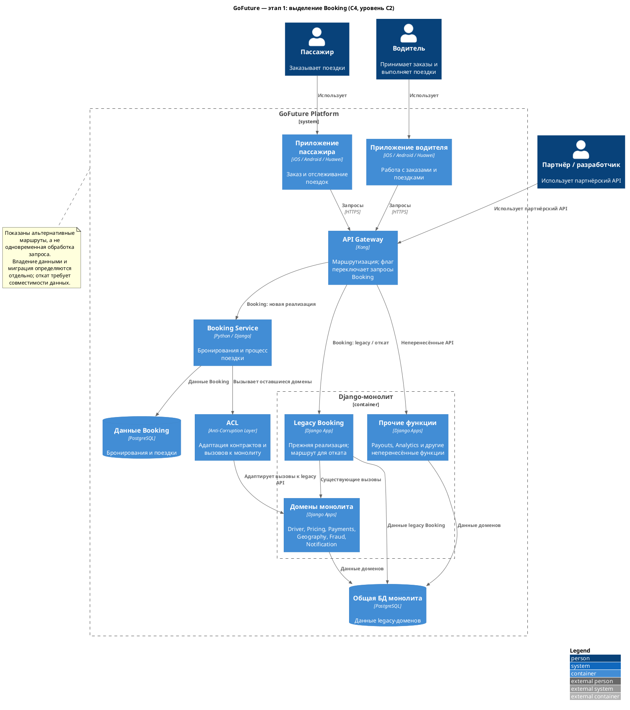
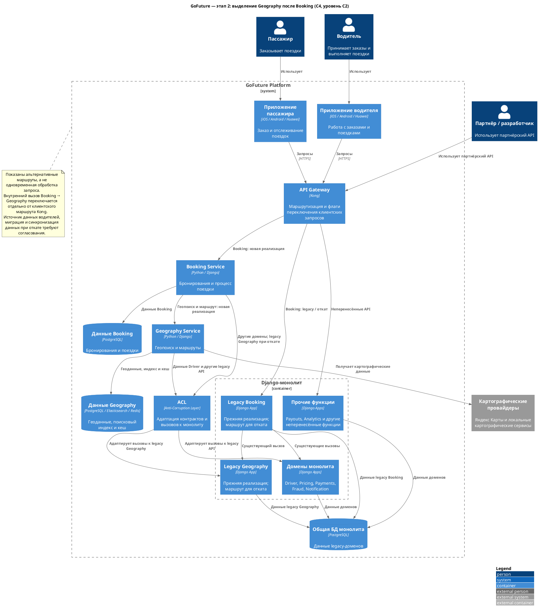

# ADR-002: Приоритетная очерёдность выделения сервисов по Strangler Fig

**Статус:** На рассмотрении  
**Дата:** Требует согласования

## Контекст

GoFuture переходит от Django-монолита к микросервисной архитектуре по паттерну Strangler Fig согласно [ADR-001](ADR-001-transition-plan.md). Система должна продолжать обслуживать поездки и развиваться во время перехода. Необходимо определить предварительную очередность выделения доменов, учитывая пользу для бизнеса, зависимости, риск и готовность команд.

За основу карты доменов и их текущих связей принята [диаграмма C3](../../../.context/C3.puml), а для обозначения сервисов, их данных и переходного контура — [целевая архитектура C2](../diagrams/C2_to_be.puml). На C2 показаны временные ACL и монолит: Gateway по флагу маршрута направляет запрос в новый сервис или в legacy-функцию. Пример схемы из другой предметной области используется только как образец визуализации: его технологии, сущности и предположения о слабой связанности Booking не переносятся на GoFuture автоматически.

## Решение

Первым кандидатом на выделение выбрать **Booking**. Остальные домены выделять поэтапно в предварительной очередности ниже. На каждом этапе неперенесённые функции остаются в монолите; маршрутизация, миграция данных, проверка и откат проектируются отдельно. Порядок пересматривается по итогам анализа зависимостей и каждого завершённого этапа.

### Почему Booking первым

- Booking непосредственно участвует в основном процессе поездки; его выделение потенциально позволит независимо развивать и масштабировать обработку заказов такси.
- Это возможность проверить подход Strangler Fig на значимом для бизнеса сценарии до последующих этапов.
- При этом Booking **не является заведомо простым кандидатом**: по C3 он синхронно взаимодействует с Driver, Pricing, Payments, Geography, Fraud и Notification, а также напрямую обращается к данным заказов и водителей в общей БД. Перенос этих вызовов за сетевую границу может повысить задержки и чувствительность к отказам.

До начала выделения необходимо подтвердить объём первого сценария, границы и владение данными, допустимое поведение при отказе зависимостей и способ безопасного переключения и отката. Независимое масштабирование Booking само по себе не гарантирует достижения целевой нагрузки, пока узкие места остаются в монолите или общей БД.

### Предварительная очередность

| Приоритет | Домен | Обоснование | Основные зависимости и условия выделения |
|-----------|-------|-------------|-------------------------------------------|
| 1 | Booking | Основной процесс поездки и возможность проверить подход на значимом сценарии. | Синхронные вызовы шести доменов, общая БД и данные водителей; определить контракты, владение данными и откат. |
| 2 | Geography | Геопоиск и маршрутизация важны для поиска водителя; возможна отдельная работа с нагрузкой геопоиска. | Booking, данные drivers и zones, Elasticsearch, кеш и Яндекс Карты; согласовать источник данных водителей и границы интеграций. |
| 3 | Driver | Данные и состояние водителей нужны для выполнения поездки. | Booking, Geography и Payouts используют данные водителя; Driver также вызывает Pricing. Согласовать владение данными и способы доступа. |
| 4 | Pricing | Динамическое ценообразование — бизнес-приоритет; выделение может упростить независимое развитие правил. | Booking и Driver вызывают Pricing; перенести правила и кеш с сохранением согласованных контрактов и результатов расчёта. |
| 5 | Fraud | Проверки участвуют в процессах заказа и оплаты. | Booking и Payments вызывают Fraud; домен напрямую читает bookings и payments. Определить необходимые данные и поведение при недоступности проверки. |
| 6 | Payments | Обработка платежей критична для продукта, но требует осторожной миграции финансовых операций. | Зависимость от Fraud, платёжного шлюза и данных payments; согласовать идемпотентность, сверку и восстановление после сбоев. |
| 7 | Payouts | Выделение отделит процесс выплат водителям и банковскую интеграцию. | Данные Driver, Celery-задачи, RabbitMQ и API банка; обеспечить корректность балансов, повторов и сверки выплат. |
| 8 | Notification | Уведомления можно выделить после первоочередных процессов поездки. | Booking вызывает домен синхронно, а задачи работают через RabbitMQ и Celery с внешними push-провайдерами; сохранить согласованное поведение во время перехода. |
| 9 | Analytics | Аналитику предлагается выделять после первоочередных транзакционных доменов. | Прямое чтение всех таблиц, события, Celery и аналитический конвейер; обеспечить доступность данных и отчётов при каждом более раннем переносе. |

Последние две позиции означают более позднее **выделение**, а не отказ от поддержки и наблюдения этих функций во время миграции. Если данные о нагрузке, зависимости или бизнес-приоритеты укажут на более раннюю пользу от их выделения, порядок следует пересмотреть.

### Первые два этапа выделения

Схемы детализируют переходный контур основной C2 на первых двух этапах Strangler Fig. Стрелки обозначают направление вызовов или доступа к данным; обе ветви маршрутизации показаны для наглядности и не означают одновременную обработку одного запроса. Хранилища обозначают логическое владение, а не обязательно отдельные серверы. Порядок миграции и синхронизации данных определяется отдельно.

#### Этап 1. Booking

Kong направляет запросы бронирования в Booking Service либо в legacy Booking внутри монолита в зависимости от флага маршрута. Прочие функции остаются в монолите. Booking Service обращается к ещё не выделенным доменам через ACL; при этом существующие взаимодействия внутри монолита продолжают работать.

[Исходный код PlantUML](../diagrams/ADR-002-stage-1-booking.puml)

#### Этап 2. Geography

После Booking выделяется Geography Service. Booking вызывает Geography напрямую по согласованному контракту; доступ Geography к данным водителей и другим необходимым функциям монолита проходит через ACL. Driver остаётся в монолите. Geography использует геоданные, поисковый индекс и кеш на PostgreSQL / Elasticsearch / Redis, а также картографических провайдеров, включая Яндекс Карты. Источник данных водителей и наполнение индекса необходимо согласовать до переключения.

Legacy Booking и Geography сохраняются на время перехода как варианты возврата, пока не проверены маршруты и данные. Вызов Booking → Geography — внутренний, поэтому его переключение между новой и legacy-реализациями проектируется отдельно от клиентских маршрутов Kong.

[Исходный код PlantUML](../diagrams/ADR-002-stage-2-geography.puml)

### ACL и обратная совместимость

**ACL (Anti-Corruption Layer)** — переходный слой адаптации между выделенными сервисами и монолитом. Через него Booking и Geography обращаются к оставшимся в монолите функциям: ACL переводит контракты, модели, форматы и ошибки между интерфейсами сервисов и legacy API, не распространяя внутреннюю модель монолита на новые сервисы. Для обратных вызовов необходимо согласовать авторизацию, таймауты, обработку отказов и наблюдаемость. Размещение ACL и конкретные протоколы определяются при проектировании; прямой доступ новых сервисов к общей БД монолита не предполагается как замена контракту.

**Обратная совместимость клиентских API и возврат трафика** обеспечиваются сохранением согласованных внешних контрактов и переключением флагов маршрутизации на стороне API Gateway Kong: запросы переводятся на новый сервис постепенно, а при необходимости направляются на соответствующую legacy-реализацию в монолите. Механизм реализации флагов и детализация маршрутов подлежат отдельному проектированию. Для внутренних вызовов, не проходящих через Kong, нужен отдельный согласованный механизм переключения, включая возврат Booking на legacy Geography через ACL.

### Миграция данных

Для каждого сервиса предварительно применяется [план миграции данных](data-migration-plan.md): пакетная загрузка согласованного снимка, догоняющая синхронизация изменений, сверка и контролируемая передача права записи. Для CDC предусмотрена связка PostgreSQL → Debezium → Kafka; её совместимость подтверждена, а настройки и восстановление необходимо проверить в пилоте. Возможность возврата маршрута в Kong не заменяет проверенный план восстановления изменений, внесённых новым сервисом. Доступность аналитики обеспечивается на каждом этапе.

Kafka предлагается для доменных и аналитических событий, а RabbitMQ сохраняется для существующих Celery-задач на переходный период; порядок сосуществования и переноса потоков описан в [ADR-003](ADR-003-kafka-rabbitmq-migration.md). Перенос сервиса не означает автоматического переноса его задач на другой брокер.

### Условия перехода между этапами

- Согласованы границы функции, владелец данных и контракты с монолитом и другими сервисами.
- Проверены критические пользовательские сценарии, совместимость и поведение при отказах; определены показатели и ответственные за мониторинг.
- Подготовлены миграция и проверка данных, постепенное переключение и проверенный план отката, включая изменения данных после переключения.
- Подтверждены готовность команды и инфраструктуры и отсутствие неприемлемого ухудшения процесса поездки.

Конкретные пороги, объём трафика и длительность наблюдения для каждого этапа требуют отдельного согласования.

## Альтернативы

| Вариант | Преимущества | Почему не выбран первым |
|---------|--------------|-------------------------|
| Начать с менее связанного домена, например Notification | Можно проверить маршрутизацию, развёртывание и наблюдаемость на потенциально менее рискованном этапе. | Предполагаемая польза для основной нагрузки поездок ниже; фактическую сложность выделения всё равно нужно проверить. Вариант остаётся допустимым пилотом, если анализ покажет неприемлемый риск Booking. |
| Начать с Driver или Geography | Эти домены важны для поиска и назначения водителей. | По C3 они связаны с общими данными водителей; их границы и влияние на Booking требуют дополнительной проверки. |
| Выделять все домены одновременно | Потенциально быстрее достигается целевая структура при достаточных ресурсах. | Резко возрастают нагрузка на команды, число одновременных изменений и сложность поиска причин сбоев; теряется преимущество поэтапной проверки. |

## Риски и меры

- **Booking остаётся зависимым от монолита.** Проверить задержки и отказы обратных вызовов; ограничивать время ожидания и предусмотреть согласованное поведение при недоступности зависимостей.
- **Расхождение данных и сложный откат.** Определить единого владельца записи на каждом этапе, сверять данные и заранее тестировать восстановление и откат, включая записи после переключения.
- **Общая БД ограничивает независимость.** Выявить прямые обращения, в том числе чтение Analytics, и поэтапно переводить их на согласованные способы доступа до прекращения старого пути.
- **План основан на неполной информации.** Проверить фактические зависимости, нагрузку, стоимость переноса и готовность команд до утверждения следующего этапа.
- **Сбои в платежах и выплатах.** До миграции соответствующих доменов согласовать идемпотентность, сверку операций, восстановление и безопасную обработку неопределённого результата.
