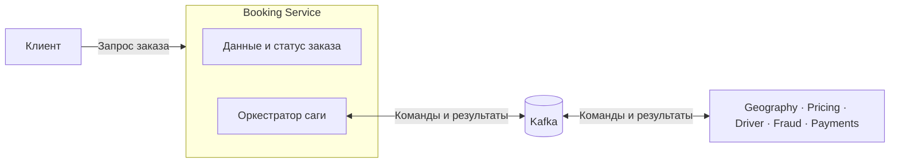
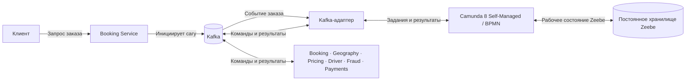

# ADR: Размещение оркестратора саги заказа поездки

**Статус:** На рассмотрении  
**Дата:** Требует согласования

## Связанные решения

- [ADR-001: выбор саги](ADR-001-saga-pattern-selection.md) — обоснование Parallel Saga и требования к надёжности процесса.
- [ADR-002: шаги саги заказа](ADR-002-booking-saga-steps.md) — предварительный перечень транзакций, ошибок и компенсаций; бизнес-правила ещё согласуются.
- [ADR-003: команды и события](ADR-003-commands-and-events.md) — предварительные команды оркестратора и результаты, которые он получает.
- [ADR-004: топики и формат сообщений](ADR-004-kafka-topics-and-messages.md) — схема топиков Kafka, ключ региона, повторы и DLQ.
- [ADR-005: мониторинг](ADR-005-monitoring.md) — метрики, логи, трассировки и алерты оркестратора и саги.
- [ADR-006: состояния и переходы](ADR-006-saga-transitions.md) — состояния процесса, которыми управляет оркестратор.
- [ADR-007: обработчики Kafka](ADR-007-kafka-consumers.md) — Python-потребители и интеграция Camunda с Kafka.
- [Целевая архитектура C2](../../../task_1/diagrams/C2_to_be.puml) — сервисы, которые участвуют в процессе, и их данные.
- [Kafka и RabbitMQ](../../../task_1/ADR/ADR-003-kafka-rabbitmq-migration.md) — обмен событиями через Kafka и переходная роль RabbitMQ.
- [Очерёдность выделения сервисов](../../../task_1/ADR/ADR-002-strangler-fig-extraction-priority.md) — порядок перехода и использование ACL для вызовов монолита.

## Контекст

В [ADR-001](ADR-001-saga-pattern-selection.md) для процесса заказа поездки предложена Parallel Saga: оркестратор асинхронно управляет шагами, отслеживает результаты и при необходимости запускает компенсирующие действия.

Процесс от заказа до окончательной оплаты после поездки затрагивает Booking, Geography, Pricing, Driver, Fraud и Payments. Booking отвечает за бронирование и его статус, остальные сервисы — за свои операции и данные. Предварительные шаги описаны в ADR-002; их точный порядок и правила оплаты ещё нужно согласовать. Необходимость предварительной платёжной операции при заказе остаётся открытой.

Необходимо выбрать, **где разместить управление сагой**: внутри Booking Service или в отдельном сервисе. При выборе важно учитывать понятность процесса, независимость изменений, задержку, восстановление после сбоев и стоимость сопровождения. В качестве платформы для асинхронных команд и событий рассматривается Kafka. Пока часть функций остаётся в монолите, обращения к ним проходят через ACL.

## Рассмотренные варианты

### Вариант 1. Оркестратор внутри Booking Service

Booking Service хранит данные заказа и управляет шагами саги. Он выполняет свои операции и через Kafka отправляет команды остальным участникам и получает результаты. Состояние саги хранится вместе с Booking; детали хранения определяются при проектировании.

### Вариант 2. Отдельный сервис-оркестратор

Booking Service создаёт заказ и инициирует сагу. Отдельный оркестратор на Camunda 8 Self-Managed хранит её состояние, ожидает результаты и управляет повторами и компенсациями. Kafka-адаптер передаёт команды и результаты между процессом и сервисами; способ его реализации уточняется в ADR-007. После подтверждения заказа процесс сохраняет состояние ожидания завершения поездки, а затем координирует расчёт стоимости и оплату. Booking остаётся владельцем данных и статуса заказа; оркестратор запрашивает изменение статуса, но не изменяет данные Booking напрямую. Payments владеет платёжными операциями и взаимодействием с провайдером.

Схемы показывают расположение логики, а не окончательные контракты сообщений. Настройки хранения и механизм взаимодействия с функциями монолита через ACL определяются отдельно.

## Сравнение вариантов

| Критерий | Оркестратор внутри Booking | Отдельный оркестратор |
|----------|----------------------------|------------------------|
| Первый запуск | Меньше компонентов; проще начать, используя существующий сервис. | Нужно разработать и развернуть отдельный сервис. |
| Ответственность | Booking управляет заказом и процессом взаимодействия с другими сервисами. | Booking управляет заказом, а оркестратор — ходом процесса. |
| Изменение процесса | Изменения логики саги обычно требуют выпуска Booking. | Логику процесса можно выпускать отдельно при совместимых контрактах; изменения участников всё равно могут потребовать их выпуска. |
| Масштабирование | Логика Booking и оркестрации масштабируется вместе. | Компоненты можно масштабировать отдельно при готовности хранилища и Kafka. |
| Отказы и восстановление | Сбой Booking влияет и на операции заказа, и на управление сагой. | Отказ оркестратора задерживает управление процессом; для него нужны отдельные восстановление и мониторинг. |
| Задержка и стоимость | Меньше отдельных компонентов и внутренних переходов между ними. | Дополнительные сообщения и отдельная инфраструктура могут увеличить задержку и стоимость. |

## Предварительное решение

Предлагается **разместить оркестратор заказа поездки отдельно от Booking и использовать Camunda 8 Self-Managed с BPMN**. Промышленное внедрение зависит от готовности инфраструктуры и результатов пилота.

Он управляет состоянием и шагами саги, но не становится владельцем бронирований, платежей или данных других доменов. Booking по-прежнему создаёт заказ и меняет его статус; Driver управляет назначением водителя; Payments отвечает за платёжные операции. Оркестратор отправляет этим сервисам команды и получает результаты асинхронно. Независимые шаги могут выполняться параллельно, если это допускают бизнес-правила.

Выбор предлагается по следующим причинам:

1. **Разделение ответственности.** Логика заказа остаётся в Booking, а управление взаимодействием нескольких сервисов сосредоточено в оркестраторе.
2. **Прозрачность.** В состоянии саги можно увидеть текущий шаг, ожидаемый ответ и ошибки процесса.
3. **Изменение процесса.** Порядок шагов и правила компенсации можно развивать отдельно от Booking, если контракты участников остаются совместимыми.
4. **Независимое масштабирование.** Нагрузку на обработку заказов и координацию саг можно оценивать и масштабировать отдельно. Достигнутую производительность необходимо подтвердить испытаниями.

### Развёртывание и хранение Camunda 8

Self-Managed выбрана как целевое направление для контроля размещения процесса и его данных по регионам. Рабочее состояние процесса хранится средствами Zeebe на постоянном хранилище; размещение, репликацию, резервное копирование и восстановление необходимо спроектировать и испытать. Для поиска и просмотра процессов требуется отдельное вторичное хранилище, например Elasticsearch или OpenSearch, поддерживаемое выбранной версией. Ни PostgreSQL, ни конкретный backend не назначаются хранилищем состояния Zeebe по умолчанию.

Платформенной и SRE-командам нужно подтвердить готовность сопровождать Camunda 8, а также оценить локализацию данных, лицензирование и стоимость. Для production Camunda рекомендует Kubernetes и Helm; существующий Docker Compose не следует считать готовой промышленной конфигурацией. Поддерживаемый способ развёртывания, версии и совместимость инфраструктуры уточняются до внедрения.

### Альтернатива: Camunda 8 SaaS

SaaS снижает нагрузку на сопровождение, но размещение компонентов и резервных копий, доступные регионы, требования к передаче данных и стоимость зависят от условий поставщика. Вариант остаётся допустимым там, где эти условия подтверждены; соответствие конкретным рынкам не предполагается автоматически.

## Риски и меры

| Риск | Меры |
|------|------|
| Оркестратор недоступен или перегружен. | Надёжно сохранять состояние саги и проверить восстановление после сбоя, обработку накопившихся сообщений и работу нескольких экземпляров. Количество копий само по себе не гарантирует корректное восстановление. |
| Потеря состояния во время длительной поездки. | Сохранять состояние ожидания и события завершения, проверять восстановление после перезапуска и обработку повторных или поздних событий. Обычное время поездки не считать зависанием саги. |
| Повтор сообщения создаст дубликат операции. | Передавать идентификаторы саги и заказа; участникам безопасно обрабатывать повторы по бизнес-данным и ограничениям своих моделей. |
| Состояние сохранено, но команда не отправлена, или наоборот. | Спроектировать согласованную запись состояния и отправку сообщения, например с помощью transactional outbox или другого проверенного механизма. |
| Компенсация не выполнена или результат платежа неизвестен. | Согласовать повторы и ручной разбор. Не выполнять платёж или возврат повторно вслепую: проверить состояние у провайдера и использовать ключи идемпотентности. |
| Дополнительный сервис и сообщения увеличат задержку и стоимость. | Измерить время обработки и нагрузку на пилоте; заранее определить бюджет и ответственных за сопровождение. |
| Сложно найти зависший заказ. | Настроить метрики, логи и алерты для состояний и длительности саг с помощью Prometheus, Grafana, Loki и Alertmanager. |

Компенсация — отдельная бизнес-операция, а не автоматический откат. Она может завершиться ошибкой; гарантировать автоматический возврат денег только за счёт оркестратора нельзя.

## Открытые вопросы

- Утвердить точную версию Camunda 8 Self-Managed, конфигурацию постоянного хранения и репликации Zeebe, резервное копирование и восстановление; выбрать совместимый backend поиска процессов.
- Проверить лицензию, стоимость, размещение данных и поддерживаемый способ production-развёртывания.
- Определить команду-владельца, бюджет, требования к доступности и порядок восстановления.
- Согласовать предварительные [шаги саги](ADR-002-booking-saga-steps.md), условия параллельного выполнения, время ожидания, повторы и компенсации.
- Спроектировать команды и события Kafka, их идентификаторы, форматы, порядок обработки и сроки хранения; проверить совместимость версий при выпуске изменений.
- Определить, как команды к функциям монолита проходят через ACL и как обрабатываются их результаты и ошибки на переходном этапе.
- Измерить задержку и пропускную способность и проверить восстановление после сбоев. Конкретные показатели для оркестратора пока не согласованы.
